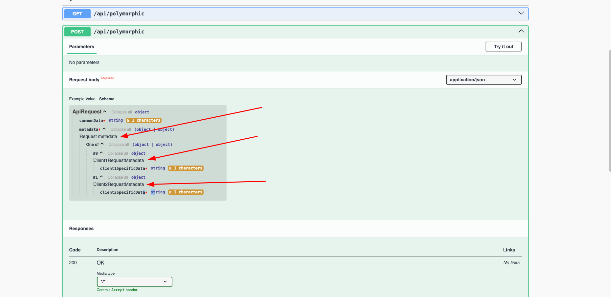

# polymorphic-api

This project represents a demonstration of a polymorphic API design.
By polymorphic, we mean that part of the api is common while part is specific to a certain client/customer (metadata).

## What the project does

The projects accept request payload, converts the payload, saves the payload to a database, and returns a response.  
Before being returned the response is post-processed (enriched) with data specific to a client/customer.

## Controlling the client/customer

Change value of `app.client.id` in `application.properties` to control which client/customer is used for the
request/response.

## Running the project

First start the database using docker-compose:

```bash
docker-compose up -d
```

Second, start the application using IntelliJ or run the following command:

```bash
./gradlew bootRun
```

## Code structure & packages

`api` package contains the common api code, while `api.dto.client1` and `api.dto.client2` packages contain the
client/customer specific code.  
`config` package contains the configuration code.  
`runtime.converter` package contains the Mapstruct mappers for converting between request->domain and domain->
response.  
`runtime.entity` package contains the domain entities.  
`runtime.repository` package contains the Spring Data JPA repositories for persisting the domain entities.  
`runtime.serialization` package contains the custom Jackson serializers to deserialize the request payloads to selected
client
DTO implementation.  
`runtime.strategy` package contains the strategy implementations for handling client/customer specific logic.
`runtime.service` package contains the service layer common logic for processing the request and response.

## OpenAPI specification

The swagger endpoint can be accessed at `http://localhost:8080/swagger-ui/index.html` after starting the application.  
From the swagger UI, it is visually clear that the request and response payloads are polymorphic, as they are defined as
`oneOf` in the OpenAPI specification.




 